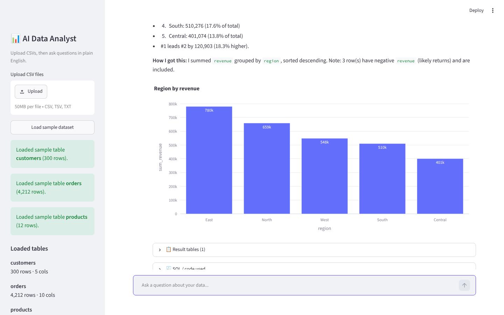
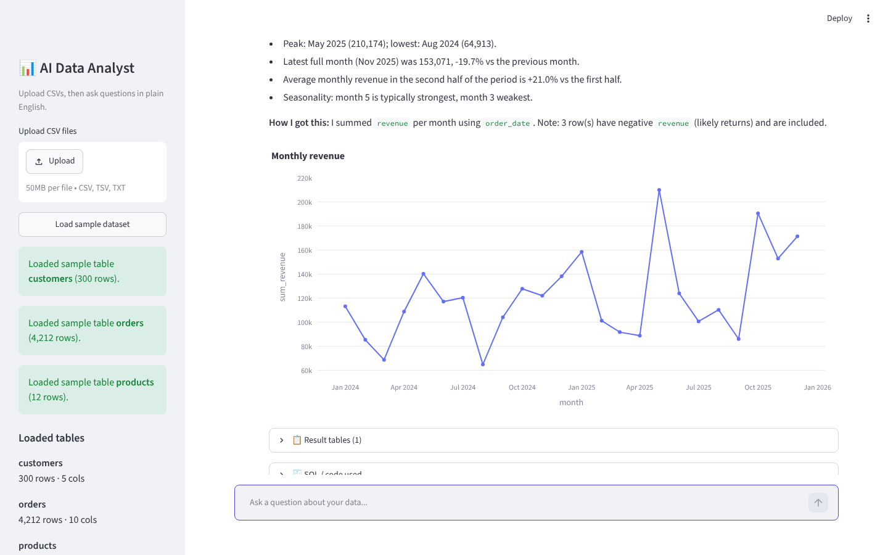
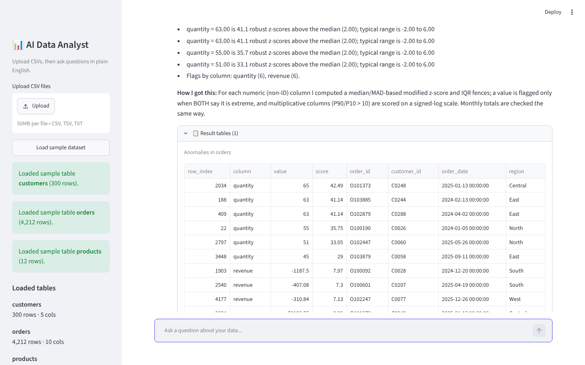
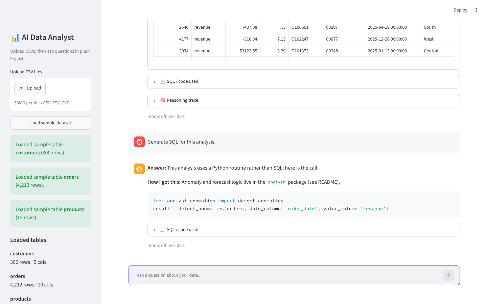
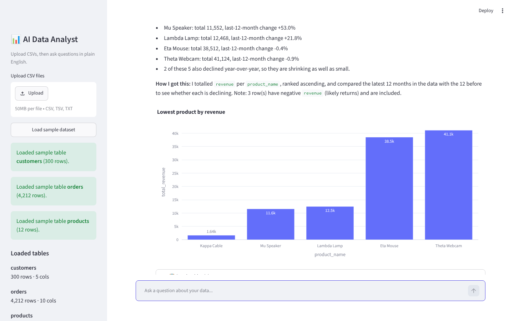
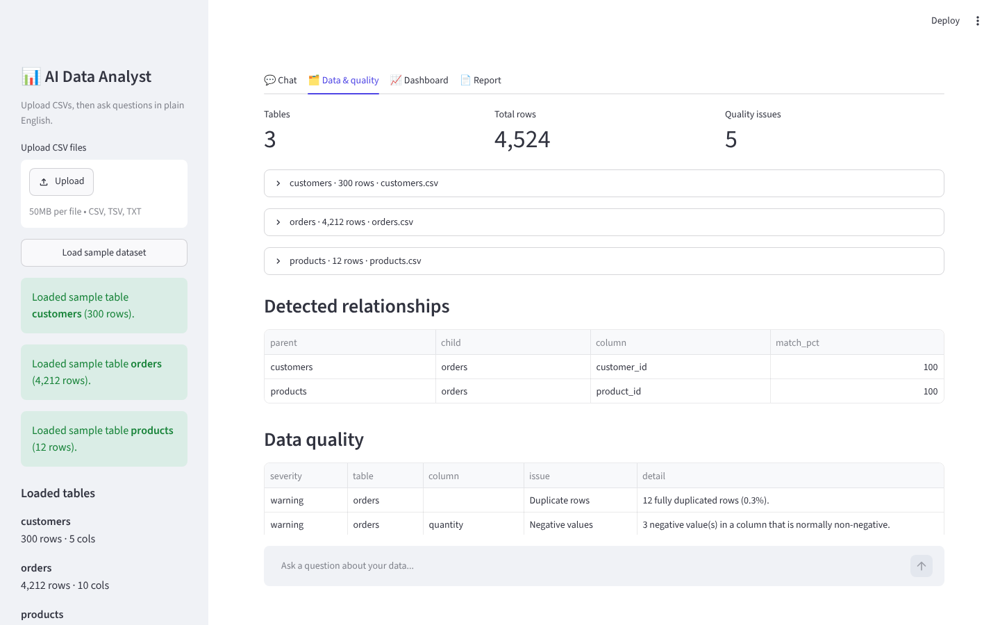
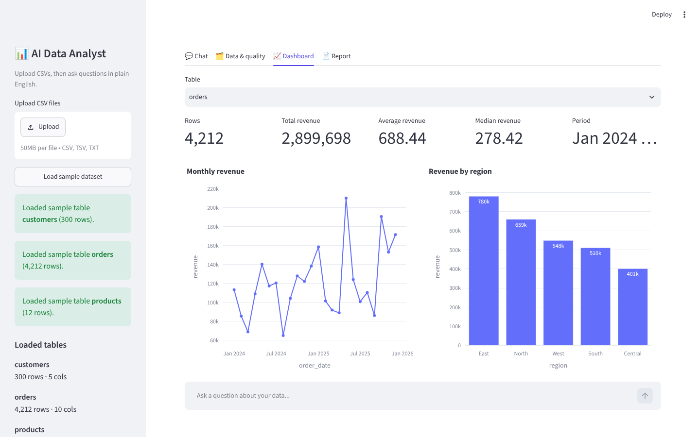
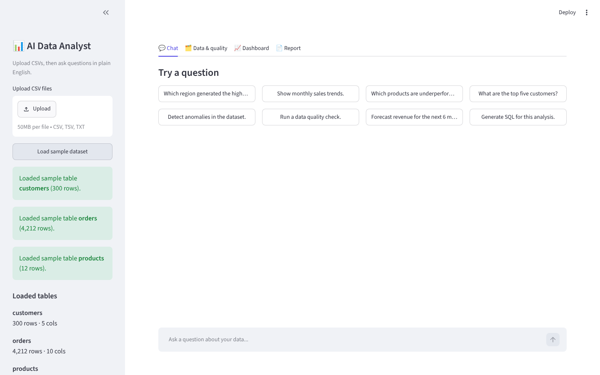
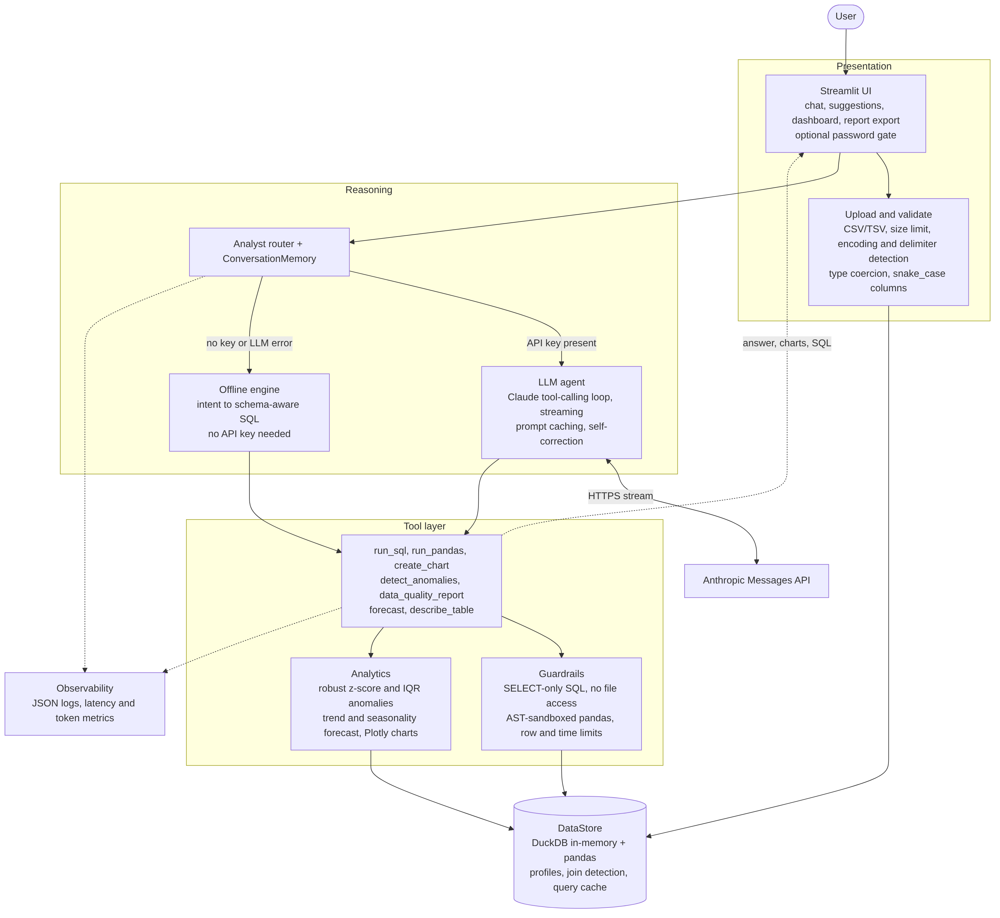

# AI Data Analyst

Upload one or more CSV files and talk to your data in plain English. The app answers questions,
writes insights, draws charts, shows the SQL or pandas it ran, flags anomalies with an
explanation, forecasts, and remembers the conversation, so follow-ups like *"now show that by
quarter"* or *"generate SQL for this"* just work.

Built for the Digital Back Office **AI Engineer assignment**.

**Demo video (28 s):** [`docs/demo.mp4`](docs/demo.mp4)  ·  **Architecture:** [`docs/architecture.png`](docs/architecture.png)

| Ask a question | Monthly trend chart |
|---|---|
|  |  |
| **Anomalies with reasons** | **Follow-up: generate SQL** |
|  |  |
| **Underperforming products** | **Data quality** |
|  |  |
| **Auto dashboard** | **Sample data loaded** |
|  |  |

## Quick start

```bash
git clone <this repo> && cd ai-data-analyst
pip install -r requirements.txt
export ANTHROPIC_API_KEY=sk-ant-...      # optional, see "Two engines" below
streamlit run app.py                     # http://localhost:8501
```

Click **Load sample dataset** in the sidebar (or upload your own CSVs) and start asking.

### Docker

```bash
cp .env.example .env                     # optionally add ANTHROPIC_API_KEY / APP_PASSWORD
docker compose up --build                # http://localhost:8501
```

## Features

| Requirement | How it is covered |
|---|---|
| Upload and validate CSVs | Multi-file upload; size limit, encoding and delimiter sniffing, type coercion, snake_case column names, duplicate/reserved name handling, friendly errors for empty or malformed files |
| Natural-language Q&A | LLM tool-calling agent, plus an offline intent engine |
| Insights and summaries | Peaks, lows, period-over-period change, seasonality, "How I got this" explanation on every answer |
| Charts | Bar, line, pie, scatter, histogram, box, heatmap via Plotly; auto dashboard tab |
| SQL / pandas code | Every answer lists the exact SQL (DuckDB) or pandas used; "Generate SQL for this analysis" reuses the previous query |
| Anomaly detection with reasons | Robust z-score (median/MAD) and IQR fences must agree; each flag says e.g. *"quantity = 63 is 41.1 robust z-scores above the median (2.00); typical range is -2.00 to 6.00"*. Monthly totals are checked too |
| Reasoning | Plain-language method note with each answer; SQL/code expander |
| Conversation context | `ConversationMemory` keeps the last N turns including the code that produced results |
| Bonus | Multi-file joins (auto-detected keys), data-quality report (duplicates, missing values, negative values, orphaned keys), forecasting, tool calling, query caching, optional password gate, HTML/Markdown report export, streaming, JSON logs and metrics, evaluation framework |

## Two engines

* **LLM agent** (when `ANTHROPIC_API_KEY` is set, or a key is pasted in the sidebar): a Claude
  tool-calling loop with a step limit, streaming, prompt caching of the schema block, and
  self-correction when a query errors.
* **Offline engine** (no key needed): maps questions to schema-aware SQL using the table profiles.
  It also takes over automatically if an LLM call fails, so the app never dead-ends.

The screenshots and video in this repo were captured with the **offline engine**, so everything you
see is reproducible without an API key.

## Architecture



Source: [`docs/architecture.mmd`](docs/architecture.mmd) (Mermaid).

```
app.py                    Streamlit UI (chat, data & quality, dashboard, report)
analyst/
  data_store.py           CSV validation, profiling, DuckDB + pandas, join detection, query cache
  sql_safety.py           SELECT-only guard, blocks file/network functions
  tools.py                tool schemas + executor (run_sql, run_pandas, create_chart, ...)
  agent.py                LLM tool-calling loop + ConversationMemory
  offline.py              no-LLM intent engine
  anomalies.py forecast.py charts.py dashboard.py report.py
  logging_utils.py        JSON logs + per-tool latency metrics
scripts/                  sample-data generator, screenshot/video capture
evals/                    15-case evaluation harness + scorecard
tests/                    pytest suite
```

### Safety and robustness

* SQL is parsed and must be a single read-only `SELECT`; `DROP`, `COPY`, `read_csv('/etc/...')` and
  similar are rejected. Queries have a timeout and row cap.
* LLM-written pandas runs in an AST-checked sandbox (no imports, no `open`/`eval`, no dunder access)
  on **copies** of the data, so the loaded tables cannot be modified.
* Tool errors are returned to the model as text so it can correct itself; the UI never shows a stack trace.
* Optional `APP_PASSWORD` gate.

## Sample data

`python scripts/generate_sample_data.py` writes `sample_data/` (seeded, reproducible):
`orders` (4,212 rows), `customers` (300), `products` (12). Orders contain planted problems on
purpose: 6 absurd quantities, 3 negative-revenue returns, 12 duplicate rows, 15 missing discounts,
1 orphaned customer key, and two weak-selling products (Kappa Cable, Mu Speaker).

## Testing and evaluation

```bash
pip install -r requirements-dev.txt
python -m pytest                 # unit + integration tests (LLM mocked)
python evals/run_evals.py        # 15 end-to-end questions vs. ground truth computed in pandas
python evals/run_evals.py --engine llm   # same cases through the LLM agent (needs a key)
```

Latest offline scorecard: **15/15** ([evals/results_offline.md](evals/results_offline.md)).

## Configuration

| Variable | Default | Purpose |
|---|---|---|
| `ANTHROPIC_API_KEY` | none | Enables the LLM agent |
| `ANALYST_MODEL` | `claude-sonnet-5-5` | Model used by the agent |
| `APP_PASSWORD` | none | Require a password before the UI loads |
| `ANALYST_MAX_UPLOAD_MB` | 50 | Upload size limit |
| `ANALYST_MAX_STEPS` | 8 | Tool-calling loop limit |
| `ANALYST_QUERY_TIMEOUT` | 20 | Seconds before a query is cancelled |
| `ANALYST_LOG_DIR` | `logs` | JSON log location |

## Assumptions and notes

* Data lives in memory per session; nothing is persisted or sent anywhere except question text,
  schema and small result samples to the Anthropic API when a key is configured.
* The LLM sees schema, column profiles and at most 40 rows per tool result, not the full files.
* Column names are normalised to snake_case on load (the app tells you when it renames).
* Relationships between files are inferred from matching key column names and value overlap.
* Negative values are treated as probable returns and included in totals, with a note shown.
* The offline engine covers common business questions (rankings, trends, shares, totals, anomalies,
  quality, forecast); open-ended analysis needs the LLM agent.
* The forecast is a trend-plus-seasonality baseline, not a tuned model.
